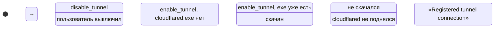
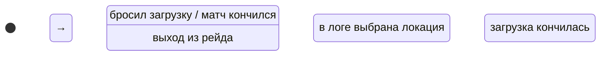
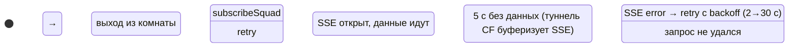
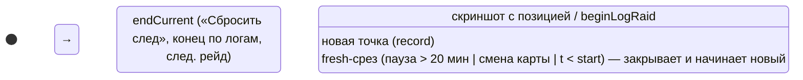
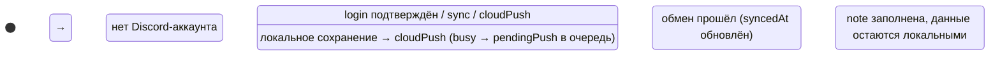
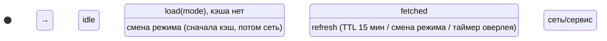

# Машины состояний Sherpa

Справочник всех процессов с фазами. Строки стадий перечисляются только в `src/lib/machines.ts`
(фронт) и в константах `UPDATE_STAGES` / `TUNNEL_STATES` (`launcher/sherpa.py`). Компоненты не
сравнивают стадии строками напрямую — только через предикаты (`updateBusy`, `tunnelOn`,
`gameInRaid`, `squadLinked`, `raidPhase`). Незнакомая стадия от лаунчера не должна ломать UI.

## 1. Обновление приложения

Носитель: `UpdateInfo.state.stage` (`src/lib/pywebview.ts`), значения — `UpdateStage` в
`src/lib/machines.ts`; переходы — `launcher/sherpa.py` (`_check_update`, `_install_update`,
`_set_update_state`). Потребители: `Shell.tsx` (кнопка в шапке), `Profile.tsx` (VersionLine,
UpdatePanel).

```mermaid
stateDiagram-v2
    [*] → idle
    idle → checking: check_update
    checking → idle: релиза нет / проверено
    checking → error: сеть/сервис недоступен
    idle → downloading: install_update
    downloading → extracting: архив скачан (3 попытки, 5 с между)
    extracting → restarting: распаковано, скрипт перезапуска
    restarting → [*]: окно закроется и откроется снова
    downloading → error: все попытки сорвались
    extracting → error
    restarting → error
    error → checking: повторная проверка
    error → downloading: повторная установка
```

Предикаты: `updateBusy(stage)` — активная установка (кнопки установки disabled);
`updateBusyLabel(stage, pct)` — подпись кнопки. Guard в лаунчере: `install_update` при busy
молча возвращает ok.

## 2. Туннель Cloudflare

Носитель: `LauncherState.tunnel_state` (`sherpa.py: _tunnel_state`), значения — `TunnelState`
в `machines.ts`. Потребитель: `Squad.tsx` (переключатель и статус).

Предикаты: `tunnelOn(state)` — переключатель «включён» (up/starting/downloading);
`tunnelStatusLabel(state, url)` — текст статуса. Ловушка: лаунчер шлёт строку, сужение —
`asTunnelState` (незнакомое → `off`, а не падение).

## 3. Стадия игры из логов

Носитель: `GameInfo.stage` (`pywebview.ts`); переходы — вотчер логов в `sherpa.py`
(`_game_set`), приходит на фронт событием `sherpa:game` (или по SSE `/api/pos/stream`).
Потребители: `App.tsx` (авто-открытие карты рейда), `PositionPanel.tsx` (строка «карта · стадия»).

Предикат: `gameInRaid(info)` — loading|raid (авто-открытие карты и тумблер действуют только тут).
Подписи: `GAME_STAGE_RU`.

## 4. Подключение сквада

Носитель: `useUI.squadPhase` (`store/ui.ts`), значения — `SquadPhase` в `machines.ts`;
источник переходов — `lib/squad.ts` `subscribeSquad` (SSE + watchdog 5 с + опрос).

Предикаты: `squadLinked(phase)` — есть живой обмен (streaming|polling); подписи `SQUAD_PHASE_RU`.
Ловушка: через туннель Cloudflare SSE может дойти одним куском при закрытии — потому watchdog
переводит на опрос GET раз в 2 с, он работает через что угодно.

## 5. Текущий рейд

Носитель: `useRaids.current` (`store/raids.ts`), фаза — `raidPhase(current)`.

Ловушки: эвристики резки в `record()` не менять без прогона на реальных треках; приложение,
перезапущенное посреди рейда, продолжает его (`init()`); `endCurrent` зовётся из `clearTrail`
(`store/ui.ts`).

## 6. Облачная синхронизация

Носитель: `useCloud` (`lib/cloud.ts`): `busy` + `note` + `info.stage` (`idle|pending|ok|error`
— лаунчер). Offline-first: облако — зеркало localStorage.

Ловушка: пришедший во время busy снимок уходит после завершения (`pendingPush`); облако новее →
`location.reload()`. Флаг `busy` + очередь — упрощённая, но честная машина: синхронизация не
реentrant.

## 7. Загрузка данных tarkov.dev

Носитель: `useData` (`store/data.ts`): `status` (`idle|loading|ready|error`) + ортогональный
`refreshing`. Уже явная машина — переходы в `load`/`refresh` (abort через `inflight`).

Ловушка: при смене режима с готовыми данными status не сбрасывается в loading (не мигать
экраном); ошибка refresh не переводит в error — цены остаются старыми.

## Известные ловушки (история багов)

- **Пинг-понг `currentMapId`** (React #185): каждый вызов сеттера дёргал подписчиков и persist;
  теперь ранний return при том же значении + tripwire (`tripwireMapLoop` в `store/ui.ts`) пишет
  в crashlog при >10 вызовах/с. Не персистить живое состояние, синхронизируемое между окнами,
  в общий ключ `sherpa:ui`.
- **SSE через туннель Cloudflare** доходит при закрытии соединения — всякий новый транспорт
  должен иметь watchdog и fallback на опрос (см. машину 4).
- **Незнакомые строки стадий** от лаунчера: всегда сужать через `asTunnelState`-подобные
  хелперы, а не приводить тип вслепую.
